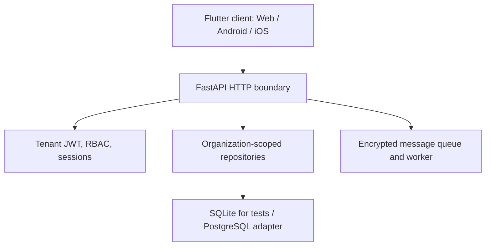
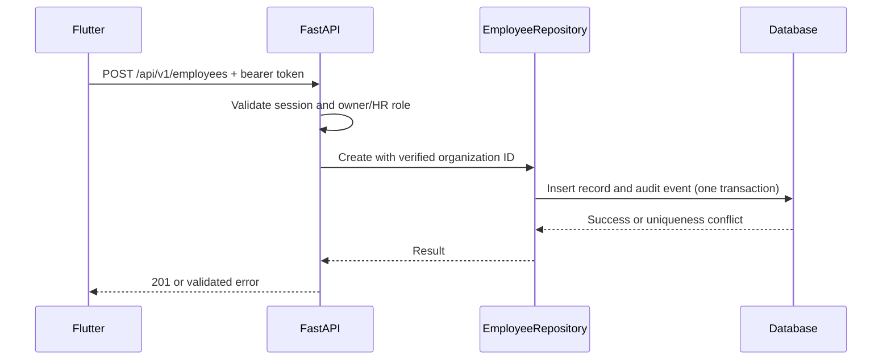

# HRM Core — Architecture and engineering decisions

**Status:** source preview, not a production-certified SaaS.

## Scope

The project is a Flutter client with a Python/FastAPI backend. Organization
ownership and employee CRUD are implemented as independent tenant-aware
operations. Android, iOS and Web share the same Flutter source. **Native builds
are planned but remain unverified** until Flutter CI has run successfully.

The database is not shared by the mobile clients. The API authenticates every
tenant request and the repository filters employee records by the verified
`organization_id`, not a company ID submitted by the client.

## Domain boundaries

| Area               | Implemented responsibility                                                            | Not yet implemented                                            |
| ------------------ | ------------------------------------------------------------------------------------- | -------------------------------------------------------------- |
| Tenant identity    | Registration, one-use email verification, login, invitations, password resets         | SSO and passkeys                                               |
| Employee directory | Create, search, paginate, edit, archive, optimistic locking, audit events             | Custom HR fields, imports, attachments                         |
| Authorization      | `owner`, `hr`, `viewer` roles; separate `platform_owner`                              | Fine-grained permission editor                                 |
| Sessions           | Short-lived access JWT and rotating refresh tokens; per-device revoke                 | Persistent device-secure mobile session storage                |
| Platform           | Company overview, suspension, plan metadata                                           | Payments, invoices, full commercial billing                    |
| Data storage       | SQLite development adapter, Psycopg PostgreSQL adapter, versioned SQL migration files | Verified live production database, backups, connection pooling |
| Delivery           | Local testing outbox or transactional encrypted queue and retry worker                | Production mail-service SLAs and monitoring                    |
| HR processes       | Employee directory                                                                    | Attendance, leave, payroll, policies and approvals             |

## Example critical path: employee creation

## Security properties (verified locally unless noted)

- Passwords: scrypt digests, never plaintext in database responses.
- Tenant separation: organization ID derived from authenticated session;
  regression checks include two fabricated tenants with different records.
- Mutations: role checks, expected-version conflict detection and audit events.
- Authentication: one-time hashed verification/invitation/recovery codes; refresh
  rotation and replay revocation; endpoint-level persistent rate limits.
- Optional mail queue: AES-256-GCM with key from private server environment;
  no secrets in the Flutter application.
- Production restrictions: `HRM_ENV=production` deliberately refuses startup
  while critical operational and compliance work is unfinished.

## Engineering trade-offs

1. **No monolithic Flutter backend logic:** repository classes wrap transport;
   the server retains authorization and transaction control.
2. **SQLite only as a development/test database:** no claim of full PostgreSQL
   parity until the live integration suite and migrations pass on a real server.
3. **Server-side secrets only:** `--dart-define` contains the public API URL,
   never signing keys or database credentials.
4. **Localization in progress:** Arabic/English locale delegates and the primary
   login, employee-directory and admin navigation are supported; a complete
   translation review of every auxiliary workflow is a remaining task.
5. **No fabricated performance benchmarks:** measure real timings, memory,
   load and device behavior before claiming optimization results.

## Next architecture work

Run CI on a real repository; verify live PostgreSQL and Flutter builds;
implement formal migration/rollback, backup/restore drills, monitoring and
rate limiting at the trusted proxy. Complete missing HR process modules and
regulatory review before using real personal data.
